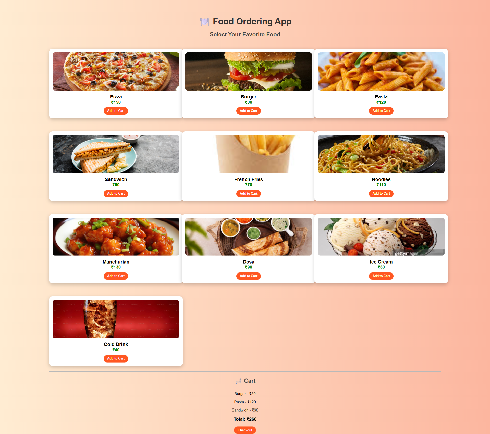
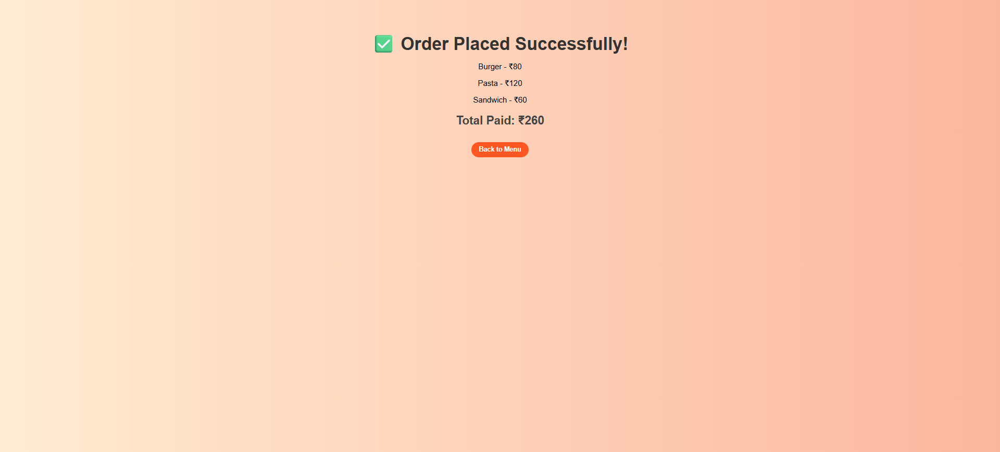

# 🍕 Food Ordering App – Flask + Docker + Jenkins

A small food ordering web app built with **Flask (Python)**, containerised with **Docker**, and built as a hands-on **CI/CD practice project** using **Git** and **Jenkins**.


---

## 📌 Features

- Browse a menu of 10 food items (Pizza, Burger, Pasta, Sandwich, French Fries, Noodles, Manchurian, Dosa, Ice Cream, Cold Drink) with prices and images
- Add items to a cart (stored in the user's session)
- Checkout page showing the ordered items and the total amount
- Cart is cleared automatically after checkout

## 🛠️ Tech Stack

| Area | Tools |
|------|-------|
| Backend | Python 3.11, Flask |
| Frontend | HTML (Jinja2 templates), CSS |
| Containerisation | Docker |
| CI/CD | Git, GitHub, Jenkins |

## 📁 Project Structure

```
food-ordering-app/
├── app.py              # Flask app: routes for home, add to cart, checkout
├── requirements.txt    # Python dependencies (Flask)
├── Dockerfile          # Docker image definition
├── .gitignore
├── static/
│   ├── style.css       # Styling
│   └── images/         # Food item images
└── templates/
    ├── index.html      # Menu + cart page
    └── success.html    # Order confirmation page
```

## 🌐 Routes

| Method | Route | Description |
|--------|-------|-------------|
| GET | `/` | Shows the menu, current cart and total |
| POST | `/add_to_cart` | Adds the selected item to the cart |
| GET | `/checkout` | Shows the order summary and clears the cart |

## 🚀 Getting Started

### Option 1: Run with Docker (recommended)

Prerequisite: [Docker](https://www.docker.com/get-started) installed.

```bash
# Clone the repository
git clone https://github.com/RakshithaDShastry/food-ordering-app.git
cd food-ordering-app

# Build the image
docker build -t food-ordering-app .

# Run the container
docker run -p 5000:5000 food-ordering-app
```

Open **http://localhost:5000** in your browser.

### Option 2: Run locally with Python

Prerequisite: Python 3.11+

```bash
git clone https://github.com/RakshithaDShastry/food-ordering-app.git
cd food-ordering-app

pip install -r requirements.txt
python app.py
```

Open **http://localhost:5000** in your browser.

## 🔄 CI/CD Pipeline (Jenkins)

## 🔄 CI/CD Pipeline (Jenkins)

The app is built and deployed with a Jenkins Pipeline job (`food-ordering-pipeline`) running on a local Windows machine. The build is started manually with **Build Now**.

```
Build Now ──▶ Clone from GitHub ──▶ Build Docker image ──▶ Replace running container
```

### Pipeline stages

1. **Clone from GitHub:** pulls the `master` branch of this repository.
2. **Build Docker Image:** builds the image `food-ordering-app` from the `Dockerfile`.
3. **Deploy Docker Container:** stops and removes the old `food-app` container (if any), then starts a new one on port 5000.

### Pipeline script

```groovy
pipeline {
    agent any

    stages {

        stage('Clone from GitHub') {
            steps {
                git branch: 'master',
                url: 'https://github.com/RakshithaDShastry/food-ordering-app.git'
            }
        }

        stage('Build Docker Image') {
            steps {
                bat 'docker build -t food-ordering-app .'
            }
        }

        stage('Deploy Docker Container') {
            steps {
                bat 'docker stop food-app || exit 0'
                bat 'docker rm food-app || exit 0'
                bat 'docker run -d -p 5000:5000 --name food-app food-ordering-app'
            }
        }
    }
}
```

### Jenkins setup notes

1. Install Jenkins and Docker Desktop on the same Windows machine.
2. Install the **Git** and **Pipeline** plugins.
3. Create a new **Pipeline** job and paste the script above into the pipeline definition.
4. Click **Build Now**, then open http://localhost:5000 to see the app.
5. To trigger builds automatically on every push, tick **Poll SCM** (or set up a GitHub webhook) under the job's Triggers.
## 📸 Screenshots




## ⚠️ Notes

- This is a learning project. There is no database or payment system; the menu is hardcoded in `app.py`.
- Before using it anywhere real, move the Flask `secret_key` into an environment variable and turn off `debug=True`.

## 🔮 Future Improvements

- Add the pipeline as a real `Jenkinsfile` in the repo
- Add an automatic build trigger (Poll SCM or GitHub webhook)
- Push the Docker image to Docker Hub from the pipeline
- Add automated tests as a pipeline stage
- Add a database and user login

📘 For the architecture diagrams and workflow, see [docs/PROJECT_OVERVIEW.md](docs/PROJECT_OVERVIEW.md).

## 📄 License

This project is for educational purposes.
