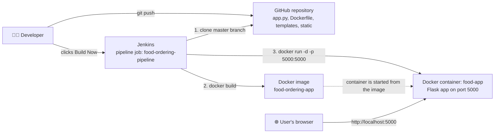
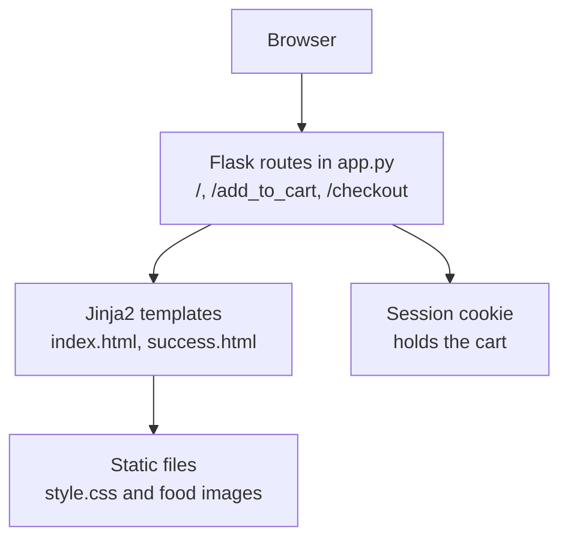
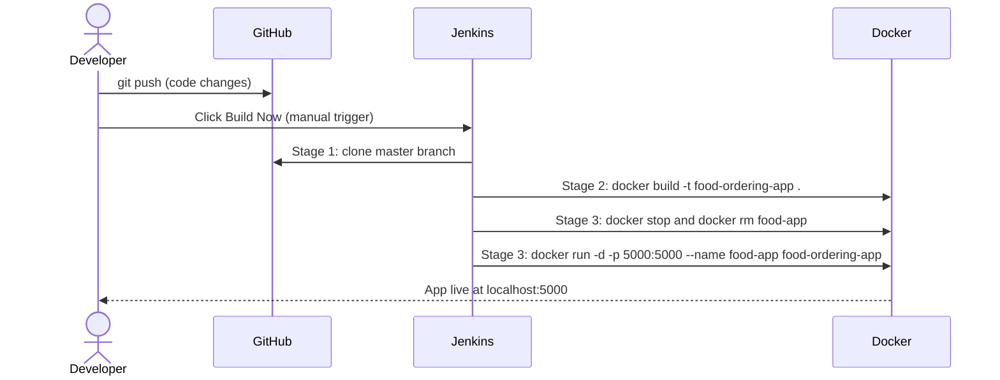
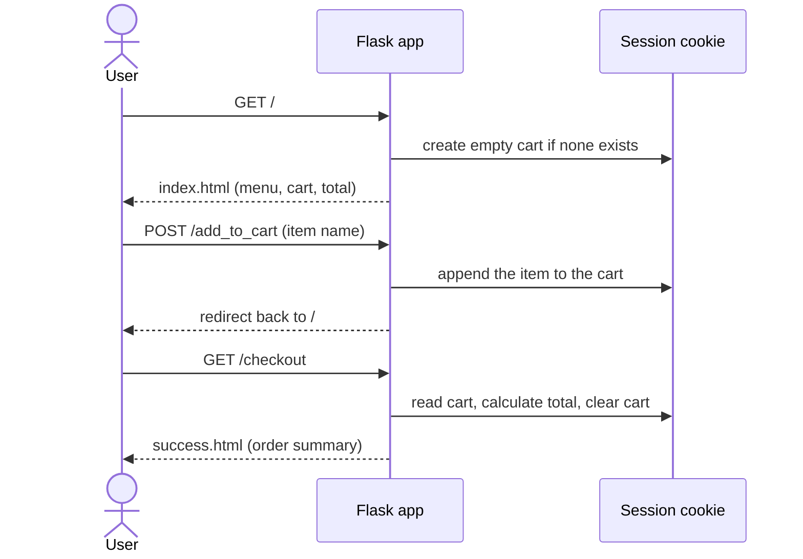

# 📘 Project Overview: Food Ordering App (Flask + Docker + Jenkins)

> A personal reference so I can remember what I built and explain it to someone else. The diagrams render automatically on GitHub.

---

## 1. In one minute

I built a small **food ordering web app** with Flask (Python) and packaged it in a **Docker** container. I then set up a **Jenkins pipeline** that clones the code from GitHub, builds the Docker image, and redeploys the container, so one click of **Build Now** takes the code from GitHub to a running app on port 5000.

**Elevator pitch:**
"It's a Flask food ordering app. Jenkins pulls the code from GitHub, builds a Docker image, and replaces the running container, so deploying is one click instead of typing the same commands every time."

---

## 2. What the app does

A user opens the site and sees a menu of 10 items (Pizza, Burger, Pasta, Sandwich, French Fries, Noodles, Manchurian, Dosa, Ice Cream, Cold Drink) with prices and images. They can add items to a cart and check out to see an order summary with the total.

| Route | Method | What happens |
|-------|--------|--------------|
| `/` | GET | Shows the menu, the current cart and the running total |
| `/add_to_cart` | POST | Finds the chosen item in the menu and adds it to the cart |
| `/checkout` | GET | Shows the order summary and total, then empties the cart |

**Where the cart lives:** in the Flask **session** (a signed cookie in the user's browser). There is no database, and the menu is a hardcoded list in `app.py`.

---

## 3. Architecture

**Reading the diagram:** the left side is the delivery path (code, then Jenkins, then image, then container), and the right side is the user reaching the running app.

### Inside the container

---

## 4. Tech stack: what each piece does

| Tool | Role in this project |
|------|----------------------|
| **Python 3.11** | Language the app is written in |
| **Flask** | Web framework: routes, sessions, template rendering |
| **HTML + Jinja2 + CSS** | The pages the user sees (`templates/`, `static/`) |
| **Git / GitHub** | Version control and the source Jenkins pulls from |
| **Docker** | Packages the app and its dependencies so it runs the same anywhere |
| **Jenkins** | Automates clone, build and deploy using a Pipeline job |

---

## 5. Workflows

### 5.1 CI/CD pipeline (what happens on Build Now)

The job runs on a local **Windows** machine, which is why the pipeline uses `bat` commands instead of `sh`. The `|| exit 0` after `docker stop` and `docker rm` stops the build from failing on the very first run, when no old container exists yet.

### 5.2 App request flow (what happens when someone orders)

---

## 6. How the Docker image is built

The `Dockerfile` does this, in order:

1. Start from the `python:3.11-slim` base image
2. Set `/app` as the working directory
3. Copy `requirements.txt` and run `pip install` (this layer is cached, so rebuilds are faster when only code changes)
4. Copy the rest of the project
5. Expose port 5000
6. Start the app with `python app.py`

---

## 7. What was and wasn't done (honest notes)

- **Manual trigger:** no build triggers were ticked in the Jenkins job (no webhook, no Poll SCM). Builds were started with **Build Now**.
- **Inline pipeline:** the pipeline script was written inside Jenkins, not stored in the repo as a `Jenkinsfile`. A copy of the script is in the README.
- **Local only:** the image was not pushed to Docker Hub, and the app was only run locally.
- **Jenkins job location:** the job lives on my local Jenkins server, not in GitHub. It was created to clone the original repo under my other account (`RakshithaDS/food-ordering-devops`).
- **Learning project:** the Flask `secret_key` is hardcoded and `debug=True` is on. That is fine for practice but should change before any real use.

---

## 8. Future improvements

- [ ] Add the pipeline as a real **`Jenkinsfile`** in the repo (pipeline as code)
- [ ] Add a **build trigger**: Poll SCM, or a GitHub webhook (for a local Jenkins, via a tunnel such as ngrok)
- [ ] **Push the image to Docker Hub** from the pipeline
- [ ] Add **automated tests** as a pipeline stage
- [ ] Add a **database** for menu items and orders, and user login
- [ ] Move `secret_key` into an environment variable and turn off `debug`

---

## 9. Questions I might be asked

**Why Docker?**
It packages the app with its dependencies, so it runs the same on any machine, and building and running takes two commands.

**Why Jenkins?**
It automates the repeated steps (clone, build, replace the container) so a deployment is one click instead of typing commands by hand.

**Was it fully automatic?**
No. I started builds manually with Build Now. Adding Poll SCM or a webhook would make it trigger on every push.

**Where is the cart stored?**
In the Flask session, which is a signed cookie in the browser. There is no database.

**What would you improve first?**
Move the pipeline into a `Jenkinsfile` in the repo, add an automatic trigger, push the image to Docker Hub, and add tests as a pipeline stage.
